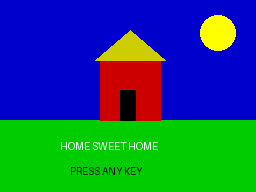

# Screen dumps

Add `{.okimate}` after an image to print it as an Okimate 10 color
printout. Without a `width`, the printout appears at its real printed
size; `print-width` sets that size in inches.

{.okimate print-width=4}

Any Okifake setting works as an attribute, in kebab-case:

```
{.okimate ribbon=black paper=copier age=0.3}
{.okimate model=oki20 pixels=0 levels=5}
```

{.okimate ribbon=black paper=copier age=0.3 print-width=3}

# Listings

A code block with the `okimate` class prints in the Okimate 10's own
font. Color tags switch ribbon colors.

```{.okimate}
{blue}10 REM {red}HOME SWEET HOME
{black}20 BORDER 1: PAPER 1: CLS
30 PRINT AT 18,8;"PRESS ANY KEY"
40 PAUSE 0
```
